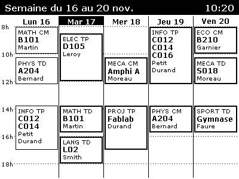
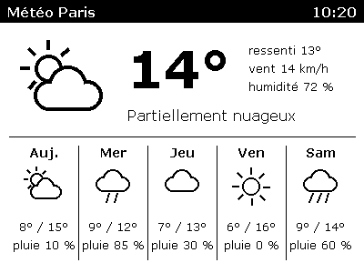
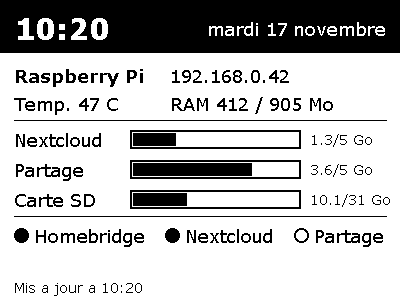

# Panneau e-paper pour Raspberry Pi

Un petit panneau d'affichage à encre électronique (e-paper 4,2", 400×300, noir et blanc) piloté par un Raspberry Pi. Il fait défiler plusieurs pages, une par minute :

| Emploi du temps | Météo | État du serveur | La nuit |
|---|---|---|---|
|  |  |  |  |

*(Captures générées avec `apercu.py` et des données fictives.)*

- **Emploi du temps** : la semaine en cours, du lundi au vendredi, lue depuis n'importe quel calendrier `.ics` (ENT, Google Agenda, Nextcloud…). Le jour actuel est en noir, les cours passés ont un cadre fin. Toutes les salles et les profs s'affichent quand il y a la place. Le week-end, c'est la semaine suivante qui s'affiche.
- **Météo** : conditions actuelles et prévisions sur 5 jours via [Open-Meteo](https://open-meteo.com/) (gratuit, sans clé ni compte). Les icônes sont dessinées par le programme.
- **État du serveur** : IP, température, RAM, remplissage des disques et état des conteneurs Docker.
- **La nuit** (0 h → 6 h par défaut) : une page « Bonne nuit » avec le prochain cours et la météo du jour, puis l'écran ne bouge plus jusqu'au matin.

L'écran se met à jour **sans clignotement** (rafraîchissement partiel). Un rafraîchissement complet, qui clignote, nettoie les traces tous les quarts d'heure. Entre deux mises à jour, l'e-paper ne consomme rien et garde son image même débranché.

Le pilote de l'écran est écrit en Python pur (~120 lignes). Il n'a besoin d'aucune bibliothèque de constructeur.

---

## Sommaire

1. [Matériel](#1-matériel)
2. [Câblage](#2-câblage)
3. [Installation](#3-installation)
4. [Configuration](#4-configuration)
5. [Lancement automatique (cron)](#5-lancement-automatique-cron)
6. [Utilisation au quotidien](#6-utilisation-au-quotidien)
7. [Comment ça marche](#7-comment-ça-marche)
8. [Pièges rencontrés et solutions](#8-pièges-rencontrés-et-solutions)
9. [Ajouter une page](#9-ajouter-une-page)
10. [Dépannage](#10-dépannage)

---

## 1. Matériel

| Élément | Détail |
|---|---|
| Raspberry Pi | testé sur un **Pi 3 B+** (1 Go) sous **Raspberry Pi OS Lite 64 bits (Debian 13 « Trixie »)**. N'importe quel Pi avec un connecteur 40 broches convient. |
| Écran | module **WeAct Studio 4,2" e-paper** noir et blanc, dalle Good Display **GDEY042T81**, contrôleur **SSD1683**, 400×300, en SPI. La dalle Waveshare 4,2" V2 utilise le même contrôleur et devrait fonctionner aussi. |
| Câbles | 8 fils Dupont femelle-femelle (souvent fournis avec l'écran) |

> **Version noir/blanc/rouge** : ce pilote vise la version **noir et blanc**. Sur la version 3 couleurs (dalle GDEY042Z98), la mémoire « rouge » est gérée différemment et le rafraîchissement partiel n'existe pas. Il faudrait adapter `epd42.py`.

## 2. Câblage

**Pi éteint**, reliez l'écran au connecteur GPIO :

| Écran | Broche physique du Pi | Signal |
|---|---|---|
| VCC | 1 | 3,3 V (**pas le 5 V**) |
| GND | 6 | masse |
| SCL | 23 | GPIO 11 — horloge SPI (SCLK) |
| SDA | 19 | GPIO 10 — données SPI (MOSI) |
| CS | 24 | GPIO 8 — CE0 |
| D/C | 22 | GPIO 25 |
| RES | 11 | GPIO 17 |
| BUSY | 18 | GPIO 24 |

> Sur ce module, les broches **SCL/SDA ne sont pas de l'I²C** : ce sont l'horloge et les données **SPI** (CLK et DIN chez d'autres fabricants).

Les numéros GPIO de D/C, RES et BUSY se changent dans `config.py`.

## 3. Installation

Sur le Raspberry Pi :

```bash
# 1. Activer le SPI (ou via « sudo raspi-config » > Interface Options > SPI)
sudo raspi-config nonint do_spi 0

# 2. Dépendances (spidev et gpiozero/lgpio sont déjà présents sur Raspberry Pi OS)
sudo apt install -y python3-pil python3-spidev python3-gpiozero python3-lgpio fonts-dejavu-core git

# 3. Droits d'accès au SPI et aux GPIO pour votre utilisateur (déconnexion/reconnexion ensuite)
sudo usermod -aG spi,gpio "$USER"

# 4. Récupérer le projet
git clone https://github.com/Adrien4951/panneau-epaper.git ~/epaper
cd ~/epaper
cp config.example.py config.py
nano config.py            # voir la section Configuration

# 5. Test : affiche l'emploi du temps
python3 ecran.py edt
```

Vérifiez que le SPI est actif avec `ls /dev/spidev0.0`. Si le fichier n'existe pas, redémarrez le Pi.

### Tester sans écran (PC, Mac ou Pi)

```bash
pip install pillow tzdata      # tzdata : nécessaire sous Windows seulement
python apercu.py               # génère docs/page-*.png avec des données fictives
python apercu.py --reelles     # sur le Pi : avec vos vraies données
```

## 4. Configuration

Tout se règle dans **`config.py`** (copie de `config.example.py`). Ce fichier est **ignoré par git** : l'adresse de votre calendrier et vos réglages ne seront jamais publiés.

| Réglage | Rôle | Défaut |
|---|---|---|
| `ICS_URL` | adresse du calendrier `.ics`. **Vide = emploi du temps fictif** de démonstration. | `""` |
| `EDT_H_DEBUT`, `EDT_H_FIN` | plage horaire de la vue semaine | 8 h → 19 h |
| `VILLE`, `LATITUDE`, `LONGITUDE` | lieu de la météo | Paris |
| `SERVICES` | conteneurs Docker à surveiller `(nom, libellé)` | homebridge, nextcloud, samba |
| `DISQUES` | jauges de remplissage `(libellé, point de montage)` | — |
| `PAGES` | pages et ordre de rotation | `["edt", "meteo", "pi"]` |
| `PERIODE_COMPLET` | un rafraîchissement complet toutes les N minutes | 15 |
| `NUIT_DEBUT`, `NUIT_FIN` | pause nocturne | 0 h → 6 h |
| `PIN_DC`, `PIN_RST`, `PIN_BUSY` | brochage (numéros BCM) | 25, 17, 24 |
| `ATTENTE_COMPLET`, `ATTENTE_PARTIEL` | attente minimale après un rafraîchissement (s) | 5,0 / 1,5 |

> **Calendrier en `http` ou `https` ?** Si votre serveur présente un certificat auto-signé, Python refusera la connexion en `https`. Utilisez l'adresse publique du site avec un vrai certificat, ou `http` en dernier recours.

### Format des titres de cours

`edt.py` découpe le titre (`SUMMARY`) de chaque événement sur ` - ` :

```
GROUPE_MATIERE - SALLE 1 / SALLE 2 - PROF 1 / PROF 2 - TYPE -
   G1_INFO     -    C012 / C014    -  PETIT / DURAND  -  TP  -
```

- le préfixe avant `_` est retiré (`G1_INFO` → `INFO`) ;
- le texte entre parenthèses dans la salle est retiré (`A204 (amphi)` → `A204`) ;
- plusieurs salles ou profs sont séparés par `/`.

Si votre calendrier suit un autre format, adaptez la fonction `decouper()` dans `edt.py`. Le champ `LOCATION` est utilisé quand le titre ne contient pas de salle.

## 5. Lancement automatique (cron)

`crontab -e`, puis ajoutez (adaptez le chemin) :

```cron
# Une page par minute (flock évite deux lancements simultanés)
* * * * * cd /home/pi/epaper && flock -n /tmp/ecran.lock /usr/bin/python3 ecran.py >> ecran.log 2>&1

# Télécharger l'emploi du temps 4 fois par jour
0 0,6,12,18 * * * cd /home/pi/epaper && /usr/bin/python3 edt.py --telecharger >> edt.log 2>&1
```

Le fichier [`crontab.exemple`](crontab.exemple) contient les mêmes lignes.

## 6. Utilisation au quotidien

```bash
python3 ecran.py                # page suivante (ce que fait le cron)
python3 ecran.py meteo          # forcer une page : edt | meteo | pi | nuit
python3 ecran.py pi --complet   # forcer un rafraîchissement complet
python3 edt.py --telecharger    # retélécharger le calendrier tout de suite
python3 edt.py --apercu         # image de l'emploi du temps dans /tmp/edt.png
```

Journaux : `ecran.log` (une ligne par affichage, avec page et type de rafraîchissement) et `edt.log` (téléchargements).

## 7. Comment ça marche

```
cron (chaque minute)
   └─ ecran.py ── choisit la page ── edt.py / meteo.py / tableau.py / nuit.py
         │                               └─ dessinent une image 400×300 (Pillow)
         └─ epd42.py ── envoie l'image en SPI ── écran
```

| Fichier | Rôle |
|---|---|
| `epd42.py` | **pilote de l'écran** : initialisation du SSD1683, rafraîchissement complet et partiel, veille |
| `ecran.py` | **chef d'orchestre** : rotation des pages, choix partiel/complet, pause nocturne |
| `edt.py` | lecture du `.ics` (avec cache), vue semaine |
| `meteo.py` | appel Open-Meteo (cache de 30 min) et icônes dessinées |
| `tableau.py` | page « état du serveur » |
| `nuit.py` | page « Bonne nuit » |
| `exemple_edt.py` | emploi du temps fictif quand `ICS_URL` est vide |
| `apercu.py` | génère les images sans écran |
| `reglages.py`, `polices.py` | chargement de `config.py` et des polices |

**Rafraîchissement partiel.** L'écran a deux mémoires : la nouvelle image (`0x24`) et l'image précédente (`0x26`). En mode partiel (`0x22 = 0xFF`), il ne redessine que les pixels qui diffèrent : environ 1 s, sans flash. Comme la mémoire est perdue pendant la veille profonde, `ecran.py` garde une copie de l'image affichée (`derniere.png`) et la renvoie dans `0x26` à chaque fois. À force, des pixels « fantômes » peuvent apparaître. D'où le rafraîchissement complet (`0x22 = 0xF7`) tous les quarts d'heure, et à chaque sortie de la page de nuit.

**Robustesse.** Si le calendrier ou la météo ne répondent pas, la dernière version en cache reste affichée. Le fichier d'état `page.txt` permet à la rotation de reprendre où elle en était, même après un redémarrage.

## 8. Pièges rencontrés et solutions

Ils ont tous été rencontrés pendant la mise au point. Ils peuvent faire gagner du temps sur un autre écran SSD16xx.

1. **Image très pâle, ancienne image encore visible.** Sans la commande **`0x18 = 0x80`** (capteur de température *interne*), le contrôleur choisit une mauvaise forme d'onde et n'« encre » pas les pixels. Elle est indispensable dans `init()`.
2. **Écran tout noir ou image à moitié dessinée.** Le rafraîchissement a été **interrompu** : le programme mettait l'écran en veille avant la fin. La ligne **BUSY** ne remontait jamais (fil mal enfiché ou broche différente). `epd42.py` attend donc toujours une durée minimale (`ATTENTE_COMPLET`), même si BUSY ne répond pas. Pour tester BUSY : sa valeur doit passer à 1 pendant environ 3 s après un rafraîchissement complet.
3. **Image retournée.** Elle est corrigée par la commande `0x01` (driver output control) avec le bon sens de balayage, et le mode d'entrée `0x11 = 0x03`.
4. **SCL/SDA marqués sur le module** : c'est bien du SPI, pas de l'I²C (voir [Câblage](#2-câblage)).
5. **Cron chaque minute** : un rafraîchissement complet dure environ 6 s avec le démarrage de Python. `flock` empêche deux instances de parler à l'écran en même temps.

## 9. Ajouter une page

1. Créez `mapage.py` avec une fonction `dessiner(now=None)` qui renvoie une image Pillow `"1"` de 400×300 (1 = blanc, 0 = noir).
2. Déclarez-la dans `ecran.py` : `PAGES = {..., "mapage": mapage.dessiner}`.
3. Ajoutez `"mapage"` à `PAGES` dans `config.py`.
4. Testez sans écran avec `apercu.py`, puis `python3 ecran.py mapage`.

Idées : prochains passages de bus ou tram, consommation d'une prise connectée, citation du jour, alertes (disque plein, service arrêté).

## 10. Dépannage

| Symptôme | Piste |
|---|---|
| `FileNotFoundError: /dev/spidev0.0` | SPI non activé → `sudo raspi-config nonint do_spi 0`, puis redémarrer |
| `PermissionError` sur SPI/GPIO | ajouter l'utilisateur aux groupes `spi` et `gpio`, puis se reconnecter |
| Image pâle ou fantômes | vérifier `0x18` dans `init()`, augmenter `ATTENTE_COMPLET`, forcer `--complet` |
| Écran noir après un test | relancer `python3 ecran.py --complet` (rafraîchissement interrompu) |
| « Aucun cours cette semaine » | `ICS_URL` vide (démo) ou injoignable → `python3 edt.py --telecharger` et lire `edt.log` |
| « Météo indisponible » | pas d'accès Internet au premier lancement (aucun cache encore) |
| `Police 'sans' introuvable` | `sudo apt install fonts-dejavu-core` |

---

Projet personnel partagé tel quel, sous [licence MIT](LICENSE). Données météo : [Open-Meteo](https://open-meteo.com/) (CC BY 4.0).
